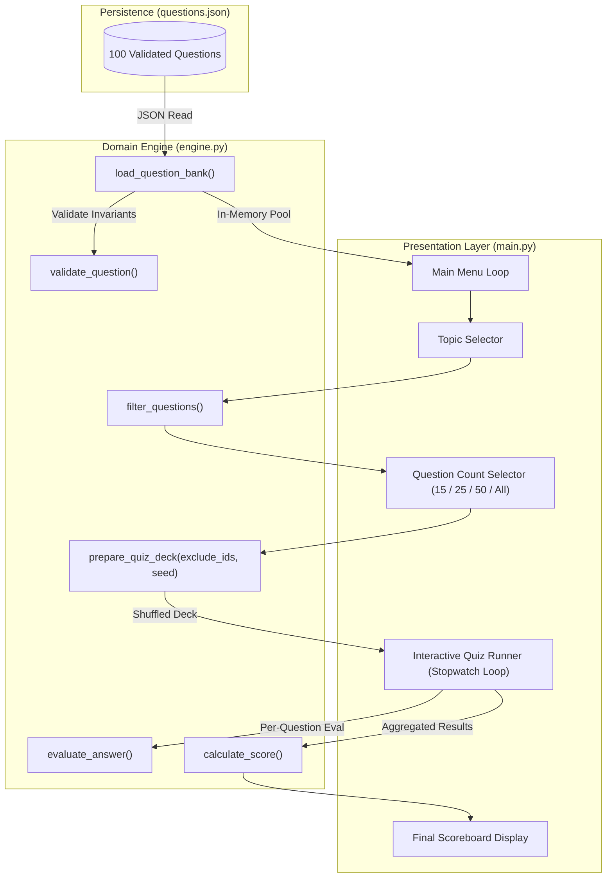

# Technical Quiz & Trivia Game

An interactive, terminal-based technical quiz engine built with Python 3.12, featuring a 100-question interview repository, decoupled JSON persistence, sub-millisecond stopwatch timing, and an immutable anti-repetition deck shuffling algorithm.

[](https://www.python.org/)
[](tests/test_quiz_engine.py)
[](../LICENSE)

---

## Overview

The Quiz & Trivia Game is Project 02 in our 10-project practical Python curriculum. The primary goal was to advance from single-ledger calculations into interactive state machines, data decoupling, and anti-repetition randomization.

The codebase strictly enforces architectural boundaries:
- `main.py`: Handles terminal presentation, ANSI screen clearing for smooth flashcard transitions, user input handling, and the per-question stopwatch timer.
- `engine.py`: A pure domain engine containing schema validators, answer evaluators, scoring logic, JSON file ingestion, and the immutable deck shuffler.
- `questions.json`: A decoupled repository of 100 interview-grade questions across 6 domains (Python, Algorithmic Thinking, Cognitive Thinking, AI Engineering, Backend Engineering, and System Design).
- `tests/test_quiz_engine.py`: A test suite verifying all domain rules, edge cases, and corruption scenarios across 19 automated unit tests.

---

## Architecture & Data Flow



### Core Responsibilities

| Component | Responsibility | Constraints |
| :--- | :--- | :--- |
| **`main.py`** | Terminal UI, stopwatch timer, screen transitions | Zero domain calculation; never directly mutates question records |
| **`engine.py`** | Validation, evaluation, scoring, deck preparation | Zero `input()` or `print()` calls; pure deterministic functions |
| **`questions.json`** | Question bank storage | Static data decoupled from Python code |
| **`tests/`** | Automated regression testing | Tests nominal paths, edge boundaries, and corruption errors |

---

## Domain Rules & Invariants

All data passing through `engine.py` must satisfy strict domain invariants:

1. **Question Record Schema (`validate_question`)**:
   - `prompt`, `topic`, and `difficulty` must be non-empty strings.
   - `options` must be a list containing at least 4 non-empty strings.
   - `answer` must exactly match one of the entries in `options`.
   - Violations raise `InvalidQuestionError` (subclass of `QuizError`).
2. **Answer Evaluation (`evaluate_answer`)**:
   - Inputs are normalized via `.strip().casefold()` to allow flexible, case-insensitive responses.
   - Empty or whitespace-only inputs immediately raise `InvalidSelectionError`.
3. **Score Calculation (`calculate_score`)**:
   - Total questions must be strictly greater than zero.
   - Correct answers must satisfy `0 <= correct <= total`.
   - Returns a structured dictionary containing total count, correct count, incorrect count, percentage rounded to 2 decimal places, and a boolean `passed` flag (threshold >= 50.0%).
4. **Anti-Repetition Deck Shuffling (`prepare_quiz_deck`)**:
   - Accepts an optional `exclude_ids: set[int]` containing questions already seen during the session.
   - Partitions the question pool into `unseen` and `seen` buckets, shuffles each bucket independently using a seeded or system random number generator, and concatenates `unseen + seen`.
   - Guarantees that players will never encounter repeated questions until the entire pool has been exhausted.
   - Slices the deck without mutating the underlying question bank.

---

## Interactive Features (`main.py`)

- **Sub-Millisecond Stopwatch Timing**: Uses `time.monotonic()` to track exact elapsed seconds for every question, penalizing questions that exceed the 30.0-second limit.
- **Letter-to-Option Mapping**: Allows players to respond with `A`, `B`, `C`, or `D`, mapping inputs to the underlying question option strings.
- **Smooth Flashcard Transitions**: Clears the terminal screen before each question and provides an explicit `[Enter]` pause so feedback is never wiped away before the user can read it.
- **Session Seen History**: Tracks seen question IDs across rounds and provides a menu option to reset history at any time.

---

## Test Coverage

The test suite in `tests/test_quiz_engine.py` covers 100% of domain routines across 19 test cases:

```text
tests/test_quiz_engine.py::test_validate_question_valid PASSED
tests/test_quiz_engine.py::test_validate_question_empty_difficulty_fails PASSED
tests/test_quiz_engine.py::test_validate_question_empty_prompt_fails PASSED
tests/test_quiz_engine.py::test_validate_question_empty_topic_fails PASSED
tests/test_quiz_engine.py::test_validate_question_fewer_than_four_options_fails PASSED
tests/test_quiz_engine.py::test_validate_question_answer_not_in_options_fails PASSED
tests/test_quiz_engine.py::test_evaluate_answer_correct_exact_and_case_insensitive PASSED
tests/test_quiz_engine.py::test_evaluate_answer_incorrect PASSED
tests/test_quiz_engine.py::test_evaluate_answer_empty_input_fails PASSED
tests/test_quiz_engine.py::test_calculate_score_passing_and_failing PASSED
tests/test_quiz_engine.py::test_calculate_score_invalid_inputs_fail PASSED
tests/test_quiz_engine.py::test_get_topic_counts PASSED
tests/test_quiz_engine.py::test_filter_questions_by_topic_and_difficulty PASSED
tests/test_quiz_engine.py::test_filter_questions_empty_filter_fails PASSED
tests/test_quiz_engine.py::test_prepare_quiz_deck_limit_seeding_and_immutability PASSED
tests/test_quiz_engine.py::test_prepare_quiz_deck_excludes_seen_questions_first PASSED
tests/test_quiz_engine.py::test_prepare_quiz_deck_invalid_limit_fails PASSED
tests/test_quiz_engine.py::test_load_question_bank_valid PASSED
tests/test_quiz_engine.py::test_load_question_bank_missing_or_corrupt_fails PASSED

============================== 19 passed in 0.17s ==============================
```

---

## Running the Application

### 1. Launch the Quiz Game
```bash
python main.py
```

### 2. Execute the Test Suite
```bash
pytest tests -v
```
